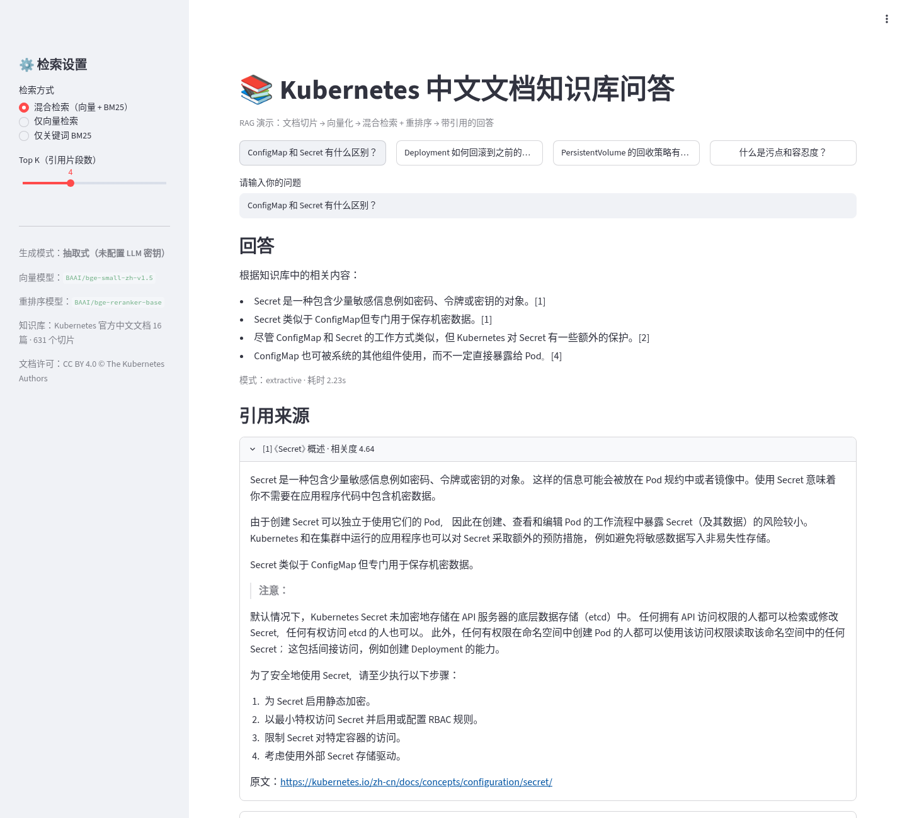
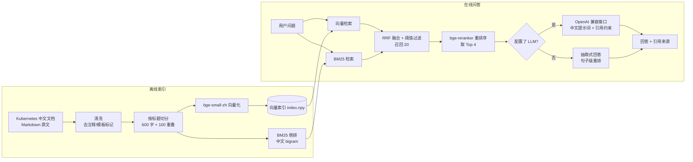
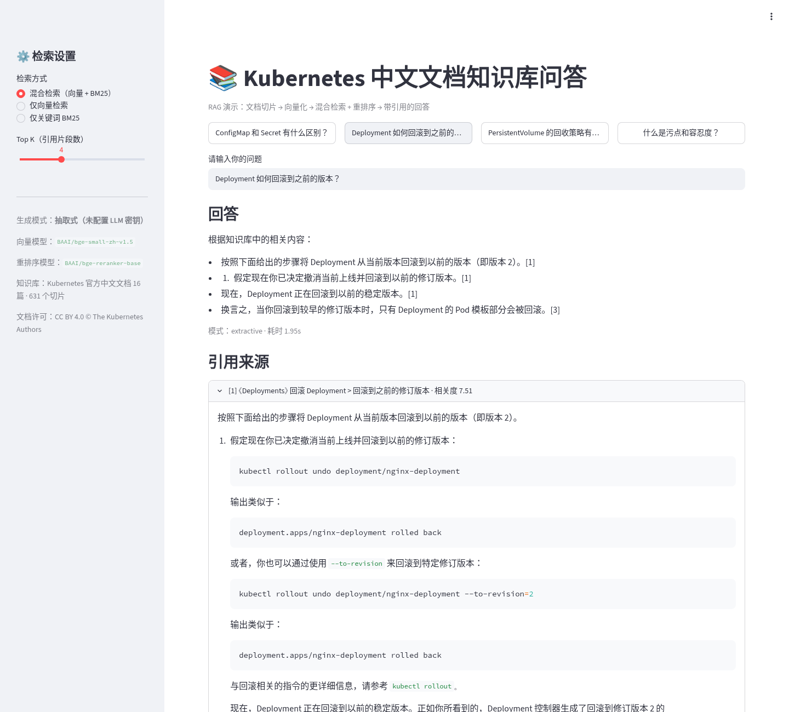
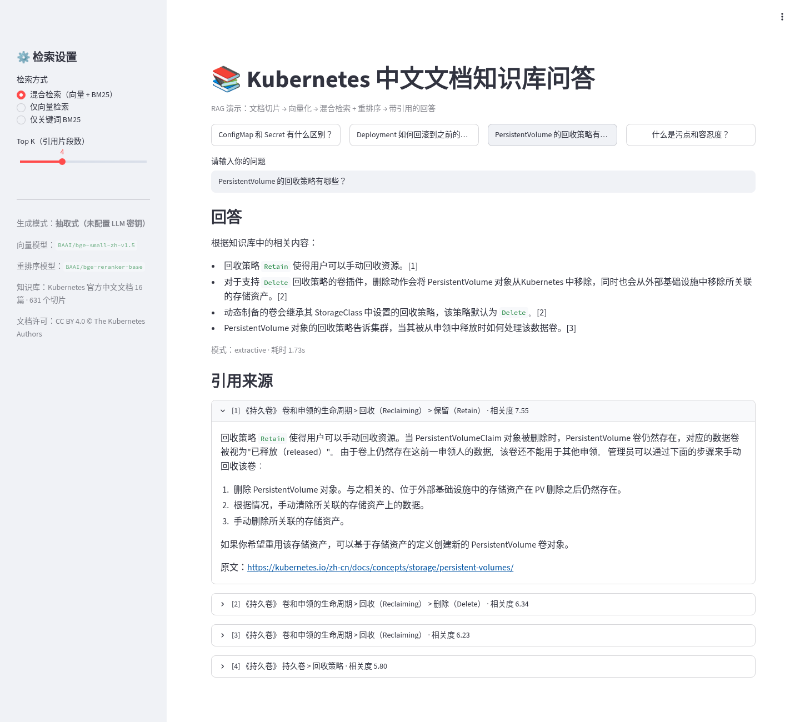

# 📚 Kubernetes 中文文档知识库问答（RAG Demo）

一个完整的 **RAG（检索增强生成）知识库问答** 示例项目，提供两种实现：

1. **Dify 版**：可直接导入 Dify 的 Chatflow DSL（知识检索 → LLM → 带引用回答），以及清洗好的待上传文档；
2. **独立 Python 版**：不依赖 Dify，本地完成 *文档清洗 → 切分 → 向量化 → 混合检索 + 重排序 → 带引用回答*，附 Streamlit 网页界面。**没有任何 API Key 也能运行**（抽取式回答模式），配置 OpenAI 兼容接口后自动切换为大模型生成。

知识库使用 [Kubernetes 官方中文文档](https://kubernetes.io/zh-cn/docs/concepts/) 中的 16 篇概念文档（CC BY 4.0），共 631 个切片。换成企业产品手册、制度文档、FAQ 等任意 Markdown 文档即可复用。



## ✨ 功能

- 中文文档清洗：去除 front matter、英文原文注释、Hugo 模板标记，超长代码示例截断
- 按标题层级切分 + 段落优先的滑动窗口（600 字 / 重叠 100 字），每个切片保留"文档 > 小节"路径
- 混合检索：`bge-small-zh-v1.5` 向量检索 + 中文 bigram BM25，用 RRF 融合
- 交叉编码器重排序：`bge-reranker-base`
- 相关度阈值拒答：知识库外的问题（如"今天天气怎么样"）直接回复"未找到"，不胡编
- 回答逐条标注 `[编号]` 引用，界面可展开查看原文片段和官方链接
- 生成层可插拔：任意 OpenAI 兼容接口（OpenAI / DeepSeek / 通义千问 / 本地 vLLM、Ollama 等）；无密钥或调用失败时自动降级为抽取式回答
- 全部模型在本地 CPU 运行（ONNX，经 fastembed），无需 GPU

## 🏗️ 架构



## 🚀 快速开始（独立 Python 版）

```bash
python3 -m venv .venv && source .venv/bin/activate
pip install -r requirements.txt

python rag/prepare_docs.py          # 清洗与切分（结果已包含在仓库中，可跳过）
streamlit run app.py                # 打开 http://127.0.0.1:8501
```

首次运行会自动下载约 1.2 GB 的向量和重排序模型（ONNX）到 `models/`，并构建向量索引（8 核 CPU 上十几秒）。

命令行测试：

```bash
python -m rag.engine "Service 有哪几种类型？"
PYTHONPATH=. python scripts/run_examples.py    # 生成 docs/example_qa.md
```

### 启用大模型生成（可选）

```bash
cp .env.example .env    # 填写后 export，或直接设置环境变量
export LLM_BASE_URL=https://api.openai.com/v1   # 任意 OpenAI 兼容地址
export LLM_API_KEY=你的密钥
export LLM_MODEL=gpt-4o-mini
streamlit run app.py
```

三个变量都存在时自动使用 LLM 模式，侧边栏会显示当前模式。

## 🧩 Dify 版：导入方法

文件：`dify/k8s_rag_chatflow.yml`（Chatflow，DSL 版本 0.3.1）

1. **创建知识库**：Dify →「知识库」→「创建知识库」→ 上传 `data/docs/` 下全部 16 个 `.md` 文件。
2. **分段设置**：选择「自定义」，分段标识符 `\n\n`，分段最大长度 `600`，分段重叠 `100`，勾选「替换连续空格/换行」。
3. **索引与检索设置**：索引方式选「高质量」，Embedding 模型任选（中文推荐 `bge-m3` 或通义 `text-embedding-v3`）；检索设置选「混合检索」，权重 语义 0.7 / 关键词 0.3（有 Rerank 模型时可改用 Rerank），Top K 4，Score 阈值 0.4。
4. **导入应用**：「工作室」→「导入 DSL 文件」→ 选择 `dify/k8s_rag_chatflow.yml`。
5. **重新绑定知识库**：打开「知识检索」节点，添加第 1 步创建的知识库（DSL 中的知识库 ID 无法跨工作区迁移，所以文件中留空）。
6. **选择模型**：在「LLM 回答生成」节点选择你已配置的模型（默认是 OpenAI `gpt-4o-mini`，可换成 DeepSeek、通义千问等）。
7. 点击「预览」测试，确认没问题后「发布」。回答下方会自动显示「引用与归属」。

Chatflow 结构：`开始 → 知识检索（混合检索 Top4）→ LLM（中文提示词，只依据参考资料，[编号] 引用）→ 直接回复`。

## 💬 示例问答（抽取式模式，无 LLM）

完整结果见 [docs/example_qa.md](docs/example_qa.md)。

**问：PersistentVolume 的回收策略有哪些？**
> - 回收策略 `Retain` 使得用户可以手动回收资源。[1]
> - 对于支持 `Delete` 回收策略的卷插件，删除动作会将 PersistentVolume 对象从 Kubernetes 中移除，同时也会从外部基础设施中移除所关联的存储资产。[2]
> - 动态制备的卷会继承其 StorageClass 中设置的回收策略，该策略默认为 `Delete`。[2]
> - PersistentVolume 对象的回收策略告诉集群，当其被从申领中释放时如何处理该数据卷。[3]
>
> 引用：[1] 《持久卷》回收 > 保留（Retain）[2] 《持久卷》回收 > 删除（Delete）[3] 《持久卷》回收（Reclaiming）

**问：Deployment 如何回滚到之前的版本？**
> - 按照下面给出的步骤将 Deployment 从当前版本回滚到以前的版本（即版本 2）。[1]
> - 现在，Deployment 正在回滚到以前的稳定版本。[1]
> - 换言之，当你回滚到较早的修订版本时，只有 Deployment 的 Pod 模板部分会被回滚。[3]

**问：今天上海天气怎么样？**
> 知识库中没有找到相关内容，请换个问法试试。（相关度阈值生效，拒答知识库外问题）

| 回滚问题 | PV 回收策略 |
|---|---|
|  |  |

## 🔍 检索设计说明

| 设计 | 选择 | 原因 |
|---|---|---|
| 切分 | 先按 `##/###/####` 标题切，再按段落合并到 ≤600 字，超长段落滑窗重叠 100 字 | 技术文档按小节组织，按标题切能保证语义完整；切片带"文档 > 小节"路径，参与向量化，也方便展示引用 |
| 向量模型 | `BAAI/bge-small-zh-v1.5`（512 维），查询加 bge 官方检索指令前缀 | 中文效果好、体积小，CPU 上也能实时检索 |
| 关键词检索 | BM25，英文按词、中文按字 bigram | 技术文档里有大量 `ConfigMap`、`Retain` 这类专有名词，纯向量检索容易漏，BM25 能补上精确匹配；bigram 不依赖分词词典 |
| 融合 | Reciprocal Rank Fusion（k=60） | 两种分数量纲不同，按排名融合最稳，不用调权重 |
| 重排序 | `BAAI/bge-reranker-base` 交叉编码器，召回 20 → 取 4 | 交叉编码器同时看问题和片段，精度明显高于双塔召回。实测在"ConfigMap 和 Secret 有什么区别"上，把一个不相关的 Deployment 片段挤出了前 4 |
| 去重 | 同一"文档 + 小节"只保留一个切片 | 让引用来源更多样，避免 4 条引用都来自同一段 |
| 拒答 | 向量相似度 < 0.35 直接过滤 | 知识库外的问题不进入生成，减少幻觉 |
| 生成 | 提示词要求只依据资料、逐条 `[编号]` 引用、资料不足时明确说"没有找到" | 让答案可溯源、可核查 |
| 无密钥降级 | 抽取式：把 Top 片段拆成句子，用重排序模型打分，取 4 句并保留引用编号 | 没有 LLM 也能给出有依据的回答，演示和测试都不依赖外部服务 |

## 📁 目录结构

```
├── app.py                     # Streamlit 界面
├── rag/
│   ├── prepare_docs.py        # 文档清洗 + 切分
│   └── engine.py              # 向量化、混合检索、重排序、生成/抽取
├── dify/k8s_rag_chatflow.yml  # Dify Chatflow DSL
├── data/
│   ├── raw/                   # 原始文档（kubernetes/website）
│   ├── docs/                  # 清洗后文档（上传到 Dify）
│   ├── chunks.jsonl           # 切片
│   └── SOURCE_AND_LICENSE.md  # 数据来源与许可
├── scripts/                   # 示例问答、截图脚本
├── docs/example_qa.md
└── screenshots/
```

## 📄 许可

- 代码：MIT License（见 `LICENSE`）
- 知识库文档：© The Kubernetes Authors，[CC BY 4.0](https://creativecommons.org/licenses/by/4.0/)，经清洗修改，详见 `data/SOURCE_AND_LICENSE.md`
- 模型：`bge-small-zh-v1.5`、`bge-reranker-base` 均为 MIT 许可（BAAI）
